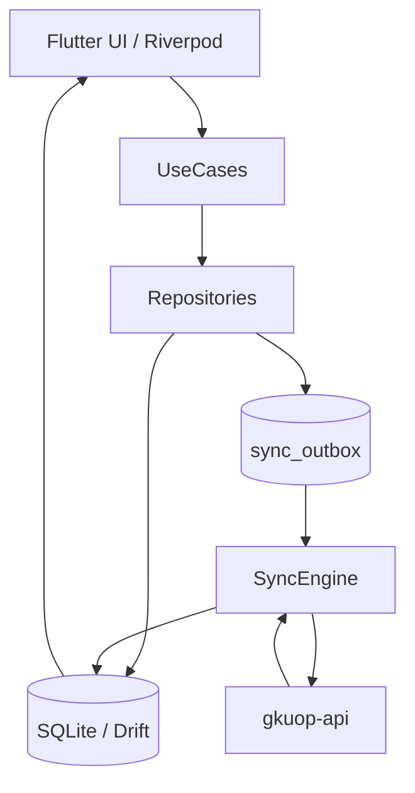

# Offline-First

## Принципы

1. UI читает только локальную БД (`watch()`).
2. Любая мутация: транзакция `UPDATE entity + INSERT outbox`.
3. Сеть — канал синхронизации, не источник экрана.
4. Нет интернета ≠ блокировка работы (кроме login и initial sync).

## Outbox

Операции: `UPDATE_TICKET`, `COMPLETE_TICKET`, `UNCOMPLETE_TICKET`, `ARCHIVE_TICKET`, `RESTORE_TICKET`, `ADD_COMMENT`, `UPLOAD_ATTACHMENT`, `DELETE_ATTACHMENT`, `ADD_TASK`, `REMOVE_TASK`.

Каждая операция: `operation_id` (UUID) → заголовок `Idempotency-Key`.

## Compaction

- Несколько `UPDATE_TICKET` одной заявки → один с актуальным payload.
- `ADD_TASK` + `REMOVE_TASK` до push → удалить оба.
- `UPLOAD` + `DELETE` до push → удалить оба и локальный файл.

## Sync triggers

appStart, appResume, connectivityRestored, manual, background (WorkManager), localMutation.

## Mutex

Single-flight lock: одновременно только один sync pipeline.
